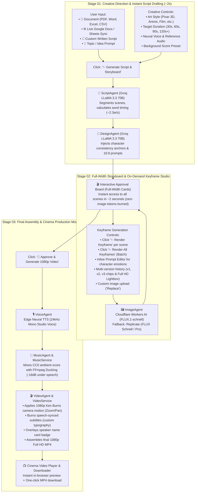

# AI Explainer Video Studio: Multi-Agent Production Architecture & System Flow

A full-stack, enterprise-grade AI Video Production Studio that transforms raw ideas, pre-written educational scripts, structured spreadsheets, or uploaded documents into finalized **1080p Full HD MP4 videos**.

The architecture employs an autonomous **Multi-Agent Orchestration Engine** combined with a human-in-the-loop **Interactive Approval Board**, providing complete creative control over visuals, narration, typography, and audio mixing.

---

## 1. High-Level System Flowchart

The application decouples scriptwriting and visual generation into a fast, quota-efficient 3-stage production lifecycle:



---

## 2. Multi-Agent Roster & Technology Stack

The backend is built around specialized, decoupled agents located in [`backend/app/agents/`](file:///d:/Marison%20Files/Marison%20Files/Marison%20Files/Application/Video-Generation-Application/backend/app/agents/):

| Agent | Current Tool / Model Used | Primary Responsibilities |
| :--- | :--- | :--- |
| **ScriptAgent** | **Groq Cloud API**<br/>`llama-3.3-70b-versatile` | • Analyzes raw text, documents, or topic prompts.<br/>• Dynamically segments content into optimal scene counts according to Target Duration (30s, 60s, 90s, 120s+).<br/>• Calculates human-sounding speech pacing (~2.3 words/second).<br/>• Extracts titles, pedagogical concept summaries, and voiceover scripts. |
| **DesignAgent** | **Groq Cloud API** + Rule Engine | • Enforces artistic aesthetic styles (3D Pixar, Cinematic 35mm, Studio Ghibli, Claymation, Cyberpunk, Watercolor).<br/>• Injects uniform **Character & Environment Anchors** to maintain cross-scene visual consistency.<br/>• Clarifies subject disambiguation (e.g. Disney Pixar red fox character design vs. generic wildlife). |
| **ImageAgent** | **Cloudflare Workers AI** (`@cf/black-forest-labs/flux-1-schnell`)<br/>*Fallback:* **Replicate** (`flux-schnell` / `flux-1.1-pro`) | • Renders crisp, photorealistic 16:9 widescreen keyframes.<br/>• Supports on-demand rendering (per-scene or full batch).<br/>• Manages image revision history (`v1`, `v2`, `v3`) allowing users to cycle between earlier and newer renders. |
| **VoiceAgent** | **Microsoft Edge Neural TTS** (`edge-tts`) | • Synthesizes human-like spoken narration across 10+ expressive neural voices (US, UK, Indian English).<br/>• Accepts user reference audio uploads (`.mp3`, `.wav`, `.m4a`), automatically normalizing to 24kHz mono WAV with instant in-browser audio verification. |
| **MusicAgent** | **Bundled Studio CC0 Audio** (Purrple Cat Master Loops) + **FFmpeg** | • Provides high-quality royalty-free background scores (`inspiring_educational`, `gentle_lofi`, `playful_curiosity`).<br/>• Manages audio ducking envelopes: background score plays at 22% volume under speech and swells during pauses, with `normalize=0` preserving 100% voiceover presence. |
| **VideoAgent** | **FFmpeg 9.0+** (`imageio-ffmpeg`) | • Orchestrates individual scene video composition.<br/>• Applies dynamic 1080p camera movement (Push-In Zoom, Pull-Back, Pan Left, Pan Right).<br/>• Burns speech-synchronized subtitles with zero-shadow typography.<br/>• Overlays optional Speaker Name Card Badges. |
| **DirectorAgent** | **FastAPI Async Pipeline Worker** | • Coordinates the end-to-end pipeline handoff between agents.<br/>• Tracks job state, progress percentage (0% to 100%), and step logs in real time via the `/api/v1/jobs/{job_id}` polling stream. |

---

## 3. Supporting Core Services

| Service | File Location | Key Capabilities |
| :--- | :--- | :--- |
| **DocumentService** | `app/services/document_service.py` | • Extracts structured text and tables from PDFs (`pypdf`), Word docs (`docx`), Excel spreadsheets (`openpyxl`), and CSV files.<br/>• Connects directly to public Google Docs and Google Sheets URLs to pull live collaborative scripts. |
| **MusicService** | `app/services/music_service.py` | • Stores permanent, bundled CC0 music assets in `app/assets/music/` tracked in Git.<br/>• Auto-syncs assets to `storage/music/` on boot.<br/>• Implements broadcast-grade FFmpeg filter graphs (`amix=inputs=2:duration=first:dropout_transition=2:normalize=0`). |
| **VideoService** | `app/services/video_service.py` | • Calculates exact audio durations via `ffprobe`.<br/>• Generates word-synchronized `.srt` subtitle tracks.<br/>• Configures ASS subtitle typography (Arial, Poppins, Montserrat, Roboto, Clean White, Golden Bold).<br/>• Concatenates scenes losslessly via FFmpeg demuxer. |
| **PipelineService** | `app/services/pipeline_service.py` | • In-memory job registry maintaining async execution status.<br/>• Handles file paths, work directories (`storage/temp/`), and video outputs (`storage/outputs/`). |

---

## 4. UI Architecture & Interactive Review Board

The frontend is built with **React 18 + Vite 5 + Tailwind CSS** and organized into three intuitive stages:

### Stage 01: Creative Direction (`StudioInputSection.jsx`)
* **Flexible Input Methods**: Upload Document, Live Google Docs/Sheets Sync, Paste Script, or Topic Prompt.
* **Art Style Picker**: Visual cards for 3D Pixar, Cinematic Film, Anime Ghibli, Claymation, Watercolor, and Cyberpunk.
* **Character Anchors**: Custom inputs for main character name, attire, hair, and environment settings.
* **Audio Controls**: Voice selector, reference voice upload with waveform playback, and background music selector.
* **Instant Script Generation**: Generates the complete storyboard in ~2 seconds with `generate_images: false`, burning 0 image quota until the user approves.

### Stage 02: Full-Width Storyboard Board (`ApprovalBoard.jsx`)
* **Full-Width Scene Cards**:
  * **Left Column (Visuals)**:
    * 16:9 Image Preview with hover overlay.
    * Full-Resolution Lightbox Zoom (`Maximize2`) with version navigation.
    * Version Switcher chips (`v1`, `v2`, `v3`) to switch between previous and new image renders.
    * **"✨ Render Keyframe"** button to generate scenes on-demand.
    * **"Edit / Regenerate"** button opening the Inline Image Prompt Editor.
    * **"Replace"** button for uploading custom diagrams or screenshots.
  * **Right Column (Audio & Presentation)**:
    * **Spoken Narration (Voiceover)**: Comfortable 4-row editor with live word count and calculated duration (`~Xs`).
    * **Speaker / Name Card Badge**: Optional overlay for speaker credits (e.g. *"Dr. Ananya Sharma • Lead Educator"*).
  * **Card Header**:
    * Scene number and title editor.
    * **Camera Movement Pill**: Push-In (Zoom), Pull-Back, Pan Left, Pan Right.
    * Delete scene button.
* **Global Storyboard Tools**:
  * **"✨ Render All Keyframes"**: Batch renderer that automatically processes all scenes sequentially with live progress counter.
  * **"Add New Scene"**: Appends a new scene card at the end of the storyboard.
  * **Subtitle Styling & Font Panel**: Real-time typography picker (Font family, font size, Clean White, Golden Bold, Boxed Yellow).

### Stage 03: Production Monitor (`ProductionMonitor.jsx`)
* Positioned at the bottom of the page in a dedicated Cinema Player layout (`min-h-[460px]`).
* Displays a live progress bar, active agent status badges, and terminal-style build logs during video compilation.
* Automatically transitions to an interactive 1080p video player with a direct **"Download MP4"** button upon completion.

---

## 5. Cloud Infrastructure & Live Deployment

The system is deployed in a modern decoupled cloud architecture:

```
┌─────────────────────────────────┐           ┌──────────────────────────────────┐
│        Frontend (Vercel)        │           │         Backend (Render)         │
│  React 18 + Vite 5 + Tailwind   │           │   Python 3.11 + FastAPI + FFmpeg │
│                                 │   HTTPS   │                                  │
│  Live URL:                      │ ────────> │   Live URL:                      │
│  https://video-gen-frontend-    │   REST    │   https://videogen-backend-ajn7. │
│  seven.vercel.app/              │   APIs    │   onrender.com/                  │
└─────────────────────────────────┘           └──────────────────────────────────┘
                 │                                              │
                 ▼                                              ▼
    GitHub: marisoncode/VideoGen-Frontend          GitHub: marisoncode/VideoGen-Backend
```

* **Intelligent API Resolver (`frontend/src/api.js`)**:
  * Automatically detects environment: in production, all requests route directly to `https://videogen-backend-ajn7.onrender.com`; in local development, requests route to `http://localhost:8000`.
* **Continuous Deployment**: Pushing to the `main` branch of either GitHub repository immediately triggers an automated cloud rebuild and zero-downtime deployment.

---

## 6. Directory Structure

```
Video-Generation-Application/
├── backend/
│   ├── app/
│   │   ├── agents/                     # Modular Agent System
│   │   │   ├── script_agent.py         # Groq LLaMA 3.3 70B Script Drafting
│   │   │   ├── design_agent.py         # Visual Style & Character Consistency
│   │   │   ├── image_agent.py          # Cloudflare / Replicate FLUX Image Renderer
│   │   │   ├── voice_agent.py          # Edge Neural TTS & Voice Reference
│   │   │   ├── music_agent.py          # Music Selection & Ducking Wrapper
│   │   │   ├── video_agent.py          # Camera Motion & Video Clip Builder
│   │   │   └── director_agent.py       # Pipeline Orchestration
│   │   ├── assets/
│   │   │   └── music/                  # Bundled Studio CC0 MP3 Loops (Git Tracked)
│   │   ├── core/
│   │   │   └── config.py               # Paths, credentials, storage directories
│   │   ├── services/
│   │   │   ├── document_service.py     # Multi-format document parser & Google Docs sync
│   │   │   ├── replicate_service.py    # Cloudflare / Replicate image client
│   │   │   ├── tts_service.py          # Edge Neural TTS engine
│   │   │   ├── music_service.py        # Music sync & FFmpeg audio ducking
│   │   │   ├── video_service.py        # FFmpeg Ken Burns motion, subtitles & assembly
│   │   │   └── pipeline_service.py     # Background job queue & execution worker
│   │   └── main.py                     # FastAPI REST API & static file mounts
│   ├── storage/                        # Server storage (uploads, outputs, music)
│   ├── requirements.txt                # Python backend dependencies
│   └── .env                            # Environment secrets (GROQ_API_KEY, etc.)
├── frontend/
│   ├── src/
│   │   ├── components/
│   │   │   ├── Header.jsx              # Navigation bar & system status
│   │   │   ├── StudioInputSection.jsx  # Stage 1: Input, art style & voice configuration
│   │   │   ├── ApprovalBoard.jsx       # Stage 2: Storyboard review, prompt editor & keyframes
│   │   │   └── ProductionMonitor.jsx   # Stage 3: Cinema progress monitor & 1080p player
│   │   ├── api.js                      # Environment-aware backend API URL resolver
│   │   ├── App.jsx                     # Top-level state & stage orchestration
│   │   └── index.css                   # Tailwind CSS styling
│   ├── package.json                    # React, Vite, Lucide dependencies
│   └── vercel.json                     # Vercel deployment routing configuration
└── PROJECT_FLOW_AND_ARCHITECTURE.md    # Master Architecture Documentation
```

---

## 7. Running Locally

### Backend Setup:
```powershell
cd backend
.\venv\Scripts\activate
pip install -r requirements.txt
python -m uvicorn app.main:app --host 127.0.0.1 --port 8000 --reload
```

### Frontend Setup:
```powershell
cd frontend
npm.cmd install
npm.cmd run dev
```

Visit `http://localhost:5173` in your browser. All API requests will automatically connect to your local backend.
